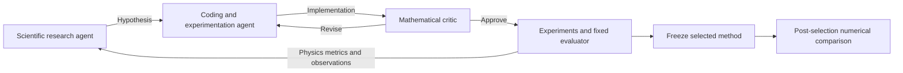

# Agentic PINN experiments

## Research question

Can autonomous agents discover better physics-informed neural network architectures and training algorithms without numerical reference solutions?

My research investigates this question through three systems: the Sitnikov restricted three-body problem, Korteweg–de Vries waves, and three-dimensional supersonic self-gravitating turbulence. The agents explore representations, activation functions, optimisation algorithms, loss formulations and training schedules. The aim is to discover reusable methods: each physical initial condition is solved with freshly trained network weights.

## Why PINNs are difficult

PINNs approximate solutions by minimising differential-equation residuals and initial or boundary errors at sampled coordinates. Their behaviour depends strongly on representation and training. An activation must support the required derivatives; an optimiser must handle competing loss terms and poorly conditioned curvature; a sampling strategy must resolve the important spatial and temporal scales.

These difficulties become pronounced near gravitational encounters, dispersive wave structures and compressible turbulent features. A method can satisfy sampled equations closely while accumulating a substantial trajectory or field error. Better physics loss is therefore a useful research signal, but it is not itself a measurement of solution accuracy.

## Our approach

The research framework separates three specialised responsibilities:

- **Scientific research agent:** studies literature, develops hypotheses and proposes architectures, optimisers and mathematical approaches.
- **Coding and experimentation agent:** implements proposals, runs experiments, records outcomes and investigates failures.
- **Mathematical critic:** checks derivations, physical consistency, implementation and conclusions.

Native Antigravity role definitions, structured proposals, critic reviews and a training approval gate implement this workflow. [Methods](methods/README.md) explains the implementation and how these responsibilities interact.

During search, agents use equations, initial/boundary data and fixed physics validation. Numerical references are withheld from selection and used afterwards to measure accuracy. Trial decisions and [literature research logs](research_logs/README.md) record what was proposed, tested, retained and rejected.

Each trial starts with a specific proposed change and an expected effect. The evaluator measures the resulting model under a fixed budget; the agents then use those observations to choose the next hypothesis. Recording unsuccessful changes matters because a promising mathematical idea can fail through numerical instability, computational overhead or poor constraint fitting.

## Experiments

**[Sitnikov three-body problem](experiments/sitnikov/README.md).** Fifty autonomous trials explored Fourier representations, gated networks, loss weighting and optimisation. Selected Trial 049 is evaluated on ten held-out initial conditions, with position and velocity compared against numerical trajectories.

**[Korteweg–de Vries equation](experiments/kdv/README.md).** A 75-trial exploratory campaign selected Trial 067, combining sinusoidal residual layers, periodic features, conservation regularisation and SOAP–AdEMAMix. The final three-seed evaluation uses trapezoidal conservation quadrature, introduced after benchmark diagnostics; this briefly distinguishes the later benchmark-informed modification from reference-free method selection.

**[3D supersonic turbulence](experiments/supersonic_3d/README.md).** The original 75-trial campaign selected Trial 069. A newer 60-trial campaign explored activation/representation changes, optimiser combinations and classical curvature methods, selecting Trial 056 with limited-memory SR1/Krylov cubic regularisation. Each campaign has its own selection and evaluation protocol.

## Results

| Experiment | Comparison | Result | Training and evaluation |
|---|---|---|---|
| Sitnikov 049 | Original MLP baseline | **43.33% lower position RMSE; 38.37% lower velocity RMSE** | Ten held-out IVPs, [0,6π]; ≈87.01 vs 4.74 s/case |
| KdV 067, trapezoidal quadrature | Published PirateNet relative L2 4.27×10⁻⁴ | **1.765196×10⁻⁴ ± 9.239126×10⁻⁶**, ≈2.419× lower | Three training seeds, 200k updates each; mean ± sample SD; published comparison, not matched FLOPs |
| Supersonic 069 | Locally trained paper-style P | **17.54% lower mean density RMS log₂ error** | Three physical seeds; ≈30 min/method/seed; full 256³ grid, t=0.8 |
| Supersonic 056 | Locally trained P | **Density relative L2 0.341969 vs 0.372813** | Physical seed 104729; three paired training seeds; 2 h/fit; full 256³ grid, t=0.8 |

## Figures

*Trial 049 and numerical reference trajectories on ten held-out IVPs. [Velocity plots and experiment details](experiments/sitnikov/README.md).*

*Reference, prediction and absolute error for each 200,000-update KdV fit. [Training curves and method](experiments/kdv/README.md).*

*Trial 056 versus Athena++ across five physical times: xy slices at z=7, physical seed 104729, training seed 823001, one fixed two-hour checkpoint. Full-volume errors are reported separately.*

*Signed velocity components for the same checkpoint and slices. [Both campaigns and numerical comparisons](experiments/supersonic_3d/README.md).*

## Current research direction

The next question is how agents should select methods when a smaller physics loss does not reliably predict a more accurate numerical solution. I am investigating physical constraints, conservation checks and consistency tests as additional selection signals, together with mathematical criticism of the proposed methods. The goal is a research workflow that discovers useful solvers and recognises when its own evidence is insufficient.
