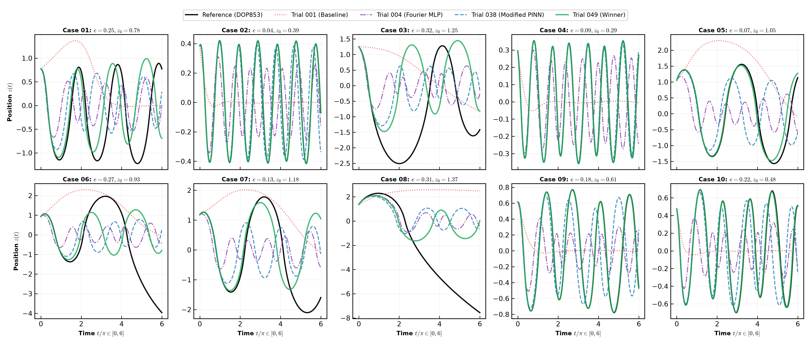
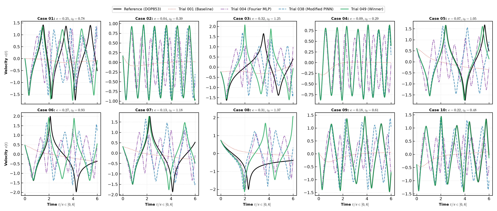
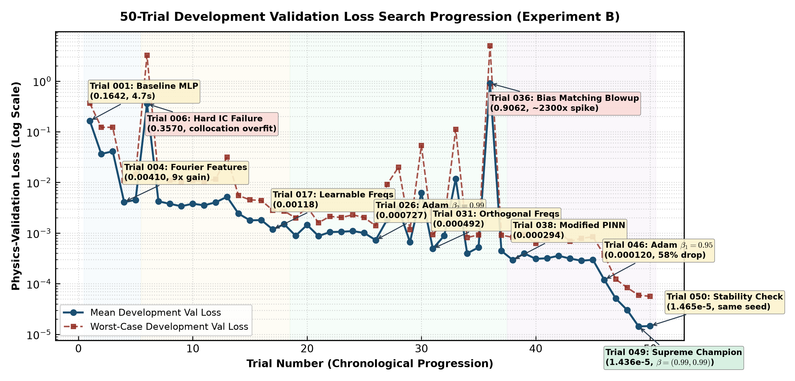
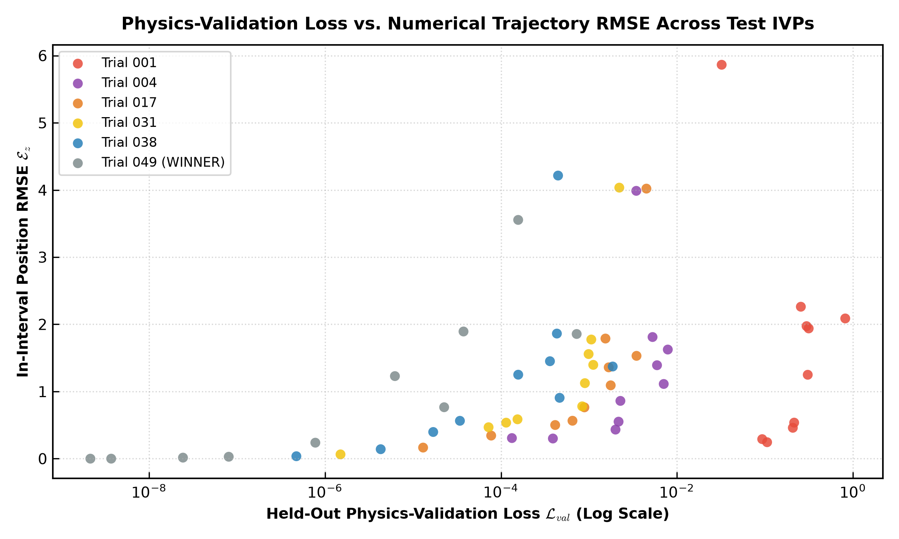
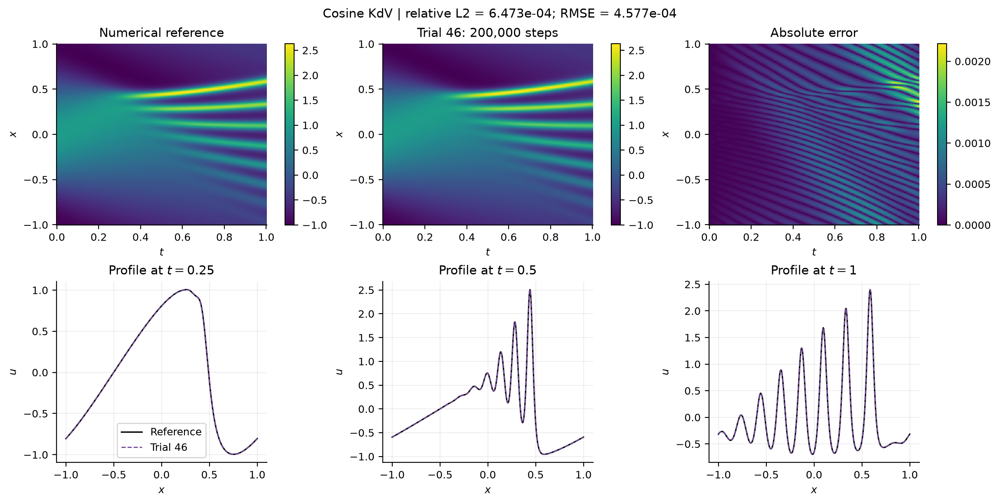
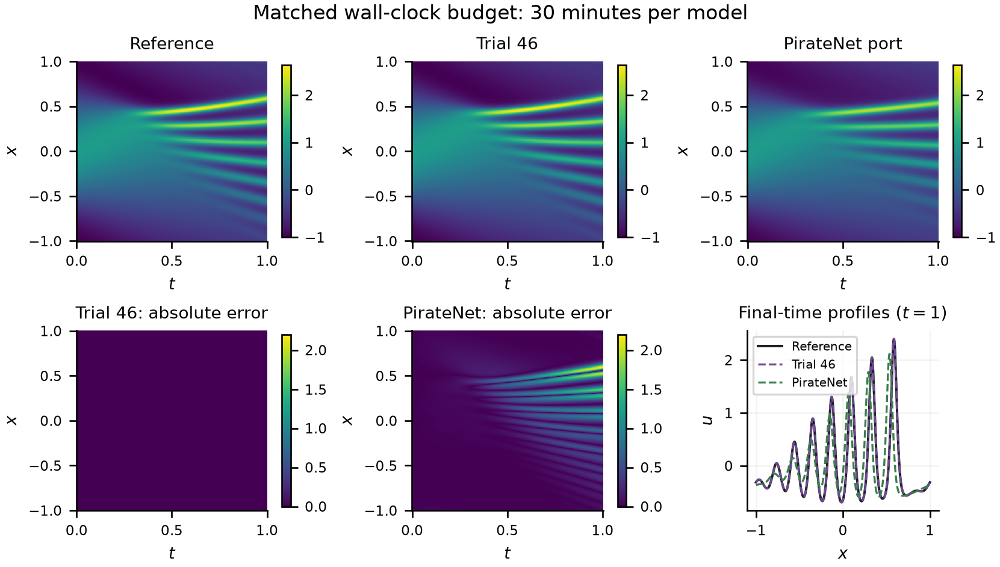
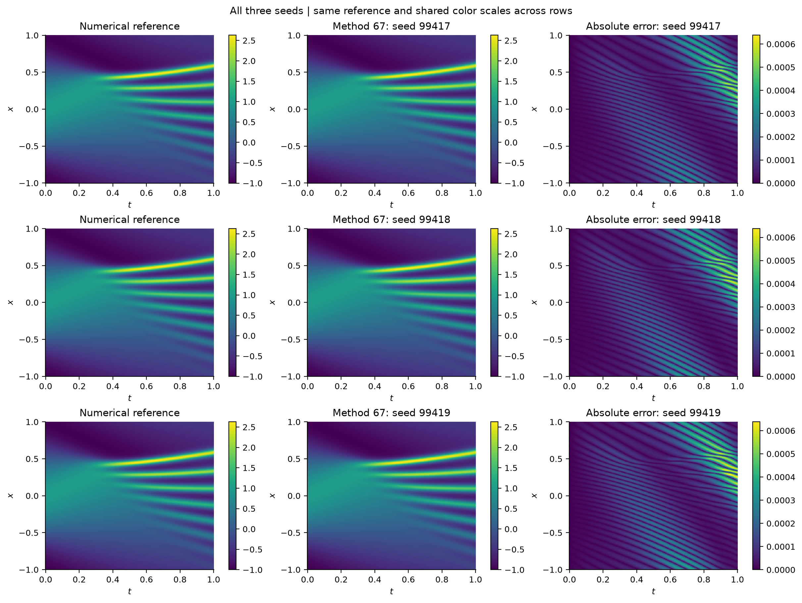
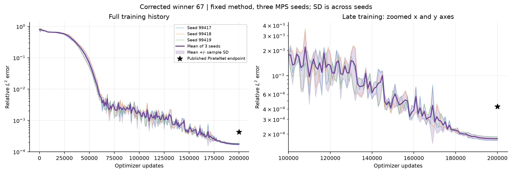
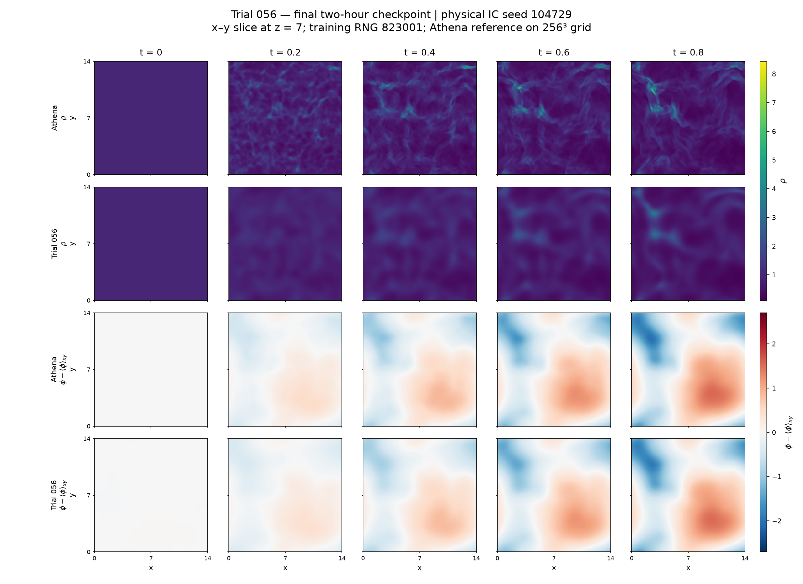
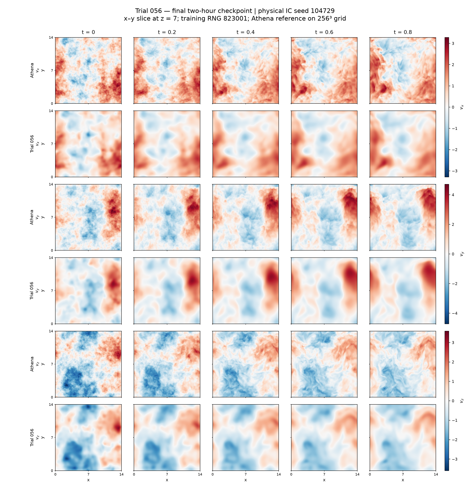

# Agentic PINN experiments

**Can autonomous research agents discover better differential-equation solvers without seeing the numerical answer?**

This research studies how an LLM can propose, implement and assess physics-informed neural network (PINN) architectures and training algorithms. Experiments cover the Sitnikov restricted three-body problem, nonlinear KdV waves, and three-dimensional self-gravitating supersonic flow. The scientific challenge is both to discover useful methods and to decide which methods deserve further testing when numerical solutions are withheld.

[Results audit](reports/CLAIM_AUDIT.md) · [Methods and agent implementation](methods/README.md) · [Reproduce the audit](reproducibility/README.md) · [Figure provenance](figures/README.md) · [Release audit](reports/RELEASE_AUDIT.md)

## Why these problems are difficult

A PINN represents a solution with a neural network and trains it to satisfy differential equations and initial/boundary conditions at sampled coordinates. Its training data need not contain interior solution labels. Architecture, activation derivatives, optimiser, loss weighting and the sampled space-time domain can all change its behaviour.

For these problems, small sampled residuals can coexist with large solution errors. Sitnikov trajectories amplify accumulated defects near close encounters; KdV requires third derivatives and fine dispersive structure; Euler–Poisson combines nonlinear transport, gravity and strongly varying spatial scales. Finite collocation, competing losses and limited compute make a low training loss insufficient evidence of a correct solution. Independent post-selection evaluation is essential.

## Research framework

The intended three-role design is shown below. **The archived campaigns demonstrate an LLM-led research loop with a deterministic evaluator and separate owner evaluation.**

The roles explore architecture, activations, optimisation, curricula and mathematical formulations. Their current implementation and evidence limits are documented in [methods/](methods/README.md). References are excluded from search to test method discovery without answer access; reference accuracy is measured after freezing, without feeding it back into that search.

## Results with explicit comparison contracts

All errors are lower-is-better. Physical cases and random training seeds are distinct experimental axes.

| Experiment | Comparison and actual training budget | Evaluation | Saved result | Evidence status |
|---|---|---|---|---|
| Sitnikov, Trial 049 | Trial 001 baseline ≈4.74 s/case; winner ≈87.01 s/case, same 90 s cap | Mean in-interval RMSE across 10 held-out IVPs | Position 1.69047 → 0.95798; velocity 0.73174 → 0.45094 | ≈43.33% / 38.37% reduction|
| KdV,  equal time | Trial 046 vs checked PyTorch/MPS PirateNet port; 30 min each, one seed | Same cosine-case relative L2 | 0.00175326 vs 0.439478 | Local single-seed comparison; different updates and parameter counts |
| KdV,  equal updates | 51,573 updates each; ≈29.95 vs 132.05 min | Same cosine-case relative L2 | 0.00175326 vs 0.00906216 | Equal updates, unequal time |
| KdV, agent-discovered Trial 067 variant | 200,000 updates each; 149.31 / 145.53 / 146.16 min, seeds 99417–99419 | Cosine-case relative L2, 201 × 512 grid | **1.765196 × 10⁻⁴ ± 9.239126 × 10⁻⁶** (mean ± sample SD) | ≈2.419× below paper value; benchmark-informed follow-up |
| Euler–Poisson, historical Trial 069 | Fresh ≈30 min/method/physical seed; local paper-style P | Full 256³ density RMS log₂ ratio at t=0.8; seeds 419, 733, 947 | Mean ≈0.3957 vs ≈0.4799 | ≈17.5% lower verified from files; seed 733 fails IC eligibility |
| Euler–Poisson, new Trial 056 | Fresh 7,200 s/method/RNG; P vs 056, physical seed 104729; 3 paired training RNGs | Full 256³ density relative L2 at t=0.8 | Mean 0.341969 vs 0.372813 | Three training RNGs on **one physical case** |

Exact input files, seeds, formulas and calculations are in [the claim audit](reports/CLAIM_AUDIT.md). The PirateNet comparator 4.27 × 10⁻⁴ is independently checked in [Wang et al., JMLR 2024, §5.2 and Table 3](https://www.jmlr.org/papers/volume25/24-0313/24-0313.pdf). It is a published endpoint, not an equal-FLOP local comparison.

## Sitnikov: dynamics, progress and a warning about residual loss

The vertical motion of a massless body is driven by two orbiting primaries. Each initial-value problem receives fresh network weights. Trial 049 combines learnable Fourier frequencies, a width-192 modified gated PINN and scheduled initial-condition weighting with Adam β=(0.99,0.99).

*Trial 049 positions against numerical trajectories on the ten held-out IVPs, over the trained interval [0,6π]. Axes use the source's nondimensional variables. Accuracy varies substantially between cases; the mean reduction is not uniform success.*

*Velocity comparisons for the same held-out interval and cases. These are distinct from untrained extrapolation to 12π.*

*Original 50-trial development-loss progression, including unsuccessful changes. These are physics-validation losses, not numerical trajectory errors. Historical annotation names are descriptive, not proofs of mechanisms.*

*Post-selection held-out physics loss versus position RMSE exposes the limits of residual-based ranking. The original short baseline did not consume the winner's training time; [the experiment note](experiments/sitnikov/README.md) also discusses the equal-compute follow-up.*

## KdV:

For the historical cosine benchmark, the equation is $u_t+u u_x+0.022^2u_{xxx}=0$, with periodic boundaries, $x\in[-1,1]$, $t\in[0,1]$, and $u(0,x)=\cos(\pi x)$. Trial 046 uses periodic/initial-state features, a residual tanh network, hard initial-condition enforcement and a temporal curriculum.

*The actual 200,000-step Trial 046 endpoint: relative L2 6.47327 × 10⁻⁴. This is the earlier method; the newer Trial 067 results are shown next.*

*30 minutes per model, one training seed: Trial 046 and a local PirateNet port. Separate colour bars quantify absolute errors. This is a local port comparison, not a reproduction of the published training result.*

The 75-exploratory branch selects Trial 067 using reference-free validation, with sinusoidal features, invariant regularisation and SOAP–AdEMAMix. The agent-discovered follow-up uses trapezoidal conservation quadrature and reaches the three-run result above. The quadrature change followed benchmark diagnostics, so this is not untouched-holdout evidence. These newer files were local and untracked, absent from all three remote branch trees at audit time; this repository preserves the selected evidence and final checkpoints.

*The same reference, individual prediction and absolute error for each of three fresh 200,000-update fits. No ensemble error is substituted for the individual-run statistic.*

*Mean and sample SD of individual errors at saved diagnostic steps; published PirateNet is a single endpoint marker. The final checkpoint is scored, rather than the best diagnostic checkpoint.*

## Euler–Poisson: transfer and the newer 60-trial campaign

These experiments approximate density, three velocity components and gravitational potential for periodic isothermal self-gravitating flow. Athena++ supplies independent numerical references after selection.

The historical Trial 069 evaluation covers three supersonic physical seeds (419, 733, 947), with fresh 30-minute fits of each method. Full-volume density RMS log₂ error improves by 17.54% relative to local P at t=0.8 on the 256³ grid. Seed 733 fails the original IC eligibility threshold; the numerical comparison and eligibility test are reported separately.

The newer campaign closed **60 attempts: 58 finite, 2 failures**. Three candidates and fresh P/B/W baselines received 1,800 seconds each. Trial 056 was selected by minimum finite total validation score, **without the earlier campaign's IC eligibility gate**. It combines periodic Snake features, random weight factorisation, time-conditioned FiLM and input skips, followed by limited-memory SR1/Krylov cubic regularisation after Adan/AdaBelief training.

*Trial 056 versus Athena++ on physical seed 104729, training RNG 823001, one fixed two-hour checkpoint across t=0,0.2,0.4,0.6,0.8. Images are 256 × 256 xy slices at z=7, not full volumes. Density is untransformed; plotted potential is slice-mean-centred. Full-volume potential errors use volume gauge alignment instead.*

*The same checkpoint and slice: reference/prediction rows for each signed velocity component. Full 256³ accuracy is recorded separately, including extreme-density and extreme-speed subsets. Three two-hour training RNGs on seed 104729 are completed; the additional reused-case pipeline was cancelled and is not counted as completed transfer evidence.*

[Historical Trial 069](experiments/euler069/README.md) · [New Trial 056](experiments/euler056/README.md)

## Limits

This is pilot evidence from selected campaigns. Actual compute, parameter counts and metrics differ across comparisons. Wall time is hardware-dependent and does not equal FLOPs. Numerical reference grids are not established converged for the supersonic cases. Stronger residual scores do not establish universal accuracy, causal attribution, statistical significance or novelty of familiar optimisation components.
