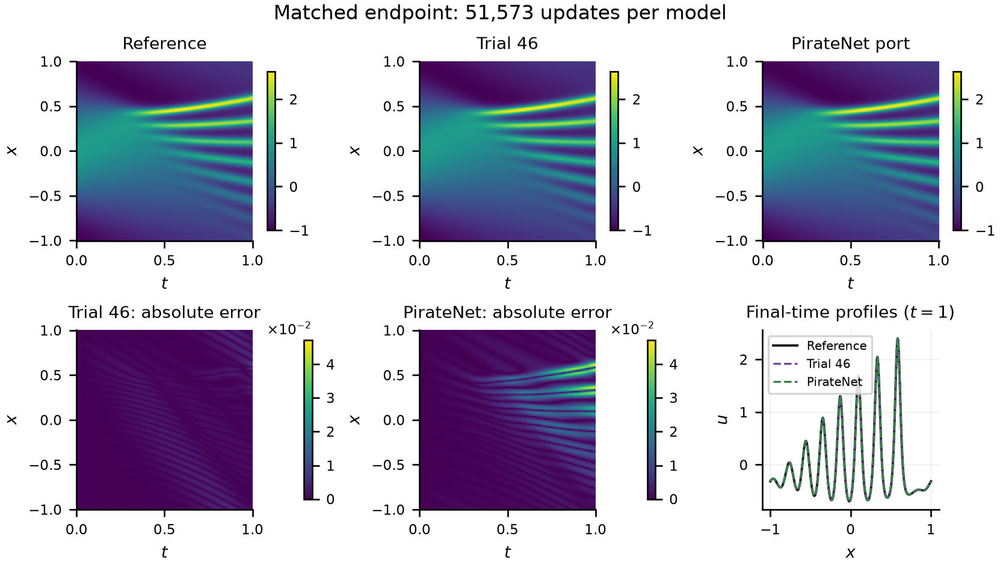

# KdV: three separate lines of evidence

## Historical cosine experiment: main

PDE: u_t + u u_x + 0.022² u_xxx = 0, x∈[−1,1], t∈[0,1], u(0,x)=cos(πx); periodic u, u_x and u_xx. Three development initial conditions are not three replicated evaluations of the held-out cosine benchmark. Original selection chooses Trial 046. Its 181,442-parameter network enforces the IC exactly and uses periodic features.

| Evaluation | Trial 046 relative L2 | Comparator | Contract |
|---|---:|---:|---|
| 30 min, seed 99417 | 0.00175326082257979 | Local PirateNet port 0.43947841375418406 | Same wall budget; 51,573 vs 11,613 updates; 181,442 vs 727,171 parameters |
| 51,573 updates, seed 99417 | 0.00175326082257979 | Local port 0.009062156376593354 | Winner ≈1,797 s vs port ≈7,923 s; unequal FLOPs |
| Adapted 200k-step schedule, seed 99417 | 0.0006473270668659449 | Archived published value 0.000427 | ≈7,023 s run loop; paper hardware/time not matched; local port not run to 200k |

Reference grid: released `kdv.mat`, 201×512 time-space pairs. Reported relative L2 is ||u_pred−u_ref||₂/||u_ref||₂. The CPU checkpoint-error table reports 0.0006473259111710943 for the final 200k checkpoint: a small device/inference difference, not a second training run. The saved source verification is included verbatim; this assembly verified the files, not a fresh checkpoint reload.

The historical 200k runner changes the original time-based schedule to a step-based curriculum and decay. It is neither a resumed 30-minute fit nor support for a newer method. The recorded published PirateNet value has not been independently checked against the original paper in this audit.

## Exploratory continuation: 75-exploratory-experiments

This branch freezes Trial 067: SOAP–AdEMAMix, sinusoidal features, hard IC, Hamiltonian invariant regularisation and temporal curriculum. Saved mean development validation loss is 4.689898828967779×10⁻⁵, with 219,650 parameters. That loss is not numerical relative L2. The branch retains the old Trial 046 comparison outputs, which does not turn those outputs into Trial 067 results.

## Agent-discovered trapezoidal conservation method: three-run evidence

The local `winner_b067_trapezoid_three_seeds` directory, identified by the owner, contains the exact newer experiment. A fresh fetch confirms only the three listed remote KdV branches; none includes these files. The working tree reports them as untracked. They are now preserved here with explicit local provenance, without changing the original repository.

| Training seed | Final relative L2 | Run-loop minutes | First checked step below 4.27×10⁻⁴ |
|---|---:|---:|---:|
| 99417 | 0.0001682912994005027 | 149.31385 | 149,000 |
| 99418 | 0.00017475315097264377 | 145.53437 | 146,000 |
| 99419 | 0.0001865144794569296 | 146.16298 | 147,000 |

Mean 0.00017651964327669201, sample SD 0.000009239125723651295. The ratio of the published PirateNet endpoint to this mean is approximately **2.419×**. Sample SD is not a confidence interval, and a ratio to a published endpoint is not an equal-FLOP or matched-hardware experiment. [The paper](https://www.jmlr.org/papers/volume25/24-0313/24-0313.pdf), §5.2 and Table 3, confirms 4.27×10⁻⁴ for the same PDE parameters and cosine initial condition.

The method integrates mass and squared-L2 conservation penalties with trapezoidal quadrature on an inclusive spatial grid. The source records the change from the original endpoint-inclusive mean rule; benchmark diagnostics had shown that rule penalised even the reference trajectory. Architecture, optimiser, penalty weights and sampling are retained from the parent. Its source hash is `94ce8f7fa29dbb035192bad0efa65f841db89884cf408d456b21433337a60d2a`, distinct from parent `82cb2913d504de2b8c347e84f6e71574d5479255d22998f7024df5bb730872ef`.

**Evaluation independence:** the integration change followed inspection of the cosine benchmark. These runs replicate an agent-discovered follow-up on a previously examined benchmark. They do not retroactively establish untouched-holdout performance for the original frozen search. During each fit reference diagnostics were recorded every 1,000 updates, without entering gradients or stopping; the scored checkpoint is the fixed final 200,000-update endpoint.

All three use fresh weights, identical source/protocol, PyTorch 2.14.1/MPS, 4,096 fresh PDE collocation points per step, invariant weight 0.10, 512 spatial quadrature points × 8 time slices, 35% step-based time expansion/optimizer warmup followed by 65% LR decay, no wall-clock cutoff. The paper run is not reproduced locally to the same training endpoint.

**Independent curation check:** each saved prediction array was compared directly with the original released `kdv.mat` grid, all 102,912 pairs. Each final checkpoint was reloaded on CPU, its 200,000 optimizer counters checked, and fresh inference recomputed. CPU relative L2 is 1.682963e−4, 1.747540e−4, 1.865112e−4, within the recorded float32 device differences (maximum prediction differences ≤5.13×10⁻⁶). Official metrics remain the saved MPS values, unchanged. The independent audit JSON, three final checkpoints, per-step errors, source and run configs are included in `evidence/corrected_three_seeds/`. The folder/source-file names retain their historical spelling.

Raw reference arrays are omitted pending dataset redistribution review; their SHA-256 and acquisition source remain traceable. All intermediate checkpoints, redundant final copies and large raw archives are omitted. See [reproducibility](../../reproducibility/README.md) for the local-artifact overlay and checkpoint audit.

## Separate three-soliton campaign: failed_solition_75

This uses u_t+6u u_x+u_xxx=0 on x∈[−4,4], t∈[−0.5,0.5], an initial trace 12/cosh²x, supplied boundary traces, 30,000 parameter cap and 5,000-step/900-second cap. It is not the periodic cosine benchmark. The authoritative final selection JSON selects Trial 022 with validation total 11.945759122636582. Its report also discusses Trial 039/075 at 26.0796; those narrative summaries must not replace the final-selection record. Its saved protocol/version is `kdv-soliton-N3-v1`.

This high-residual campaign and its human-only evaluations are useful failure evidence. No soliton score or fit is used to substantiate the cosine three-run claim. Original checkpoint paths exist in the branch inventory, but existence alone does not establish their support for that claim.
