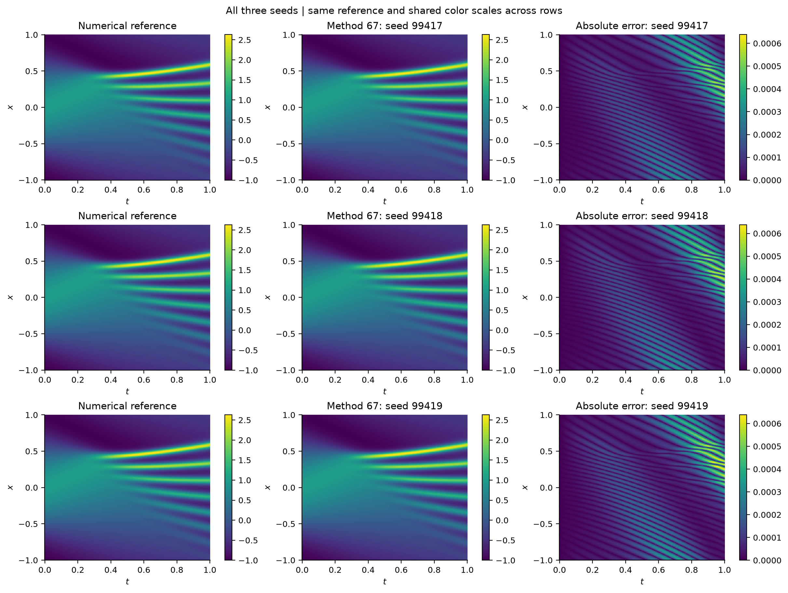
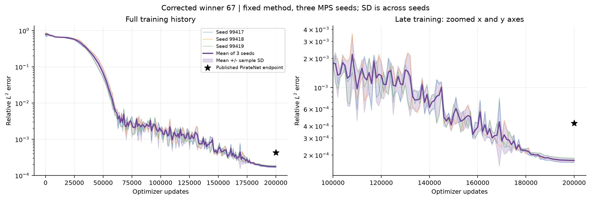

# Korteweg–de Vries equation

The periodic KdV problem is

\[
u_t+u u_x+0.022^2u_{xxx}=0,\qquad x\in[-1,1],\ t\in[0,1].
\]

The 75-trial exploratory campaign uses three development initial conditions, physics-based validation and fresh weights per case. The later cosine benchmark uses u(0,x)=cos(πx) and a numerical reference on a 201×512 time–space grid.

Selected **Trial 067** combines an eight-layer width-176 sinusoidal residual network, periodic features, hard initial conditions, conservation regularisation and SOAP–AdEMAMix. The final evaluation uses trapezoidal conservation quadrature, introduced after benchmark diagnostics; this is a later modification of the reference-free selected method.

| Training seed | Updates | Relative L2 | Run-loop minutes |
|---|---:|---:|---:|
| 99417 | 200,000 | 1.682913×10⁻⁴ | 149.31 |
| 99418 | 200,000 | 1.747532×10⁻⁴ | 145.53 |
| 99419 | 200,000 | 1.865145×10⁻⁴ | 146.16 |
| **Mean ± sample SD** | | **1.765196×10⁻⁴ ± 9.239126×10⁻⁶** | |

[PirateNet's published value](https://www.jmlr.org/papers/volume25/24-0313/24-0313.pdf), §5.2/Table 3, is 4.27×10⁻⁴: approximately 2.419 times the three-run mean. This is a published-benchmark comparison, not matched hardware or FLOPs.

*Reference, prediction and absolute error for each final model, using shared field and error scales.*

*Individual relative-L2 histories and mean ± sample SD. The final 200k checkpoint is scored; numerical references are diagnostic during these post-selection runs.*

[Experimental report](report.md) · [75 trial decisions](decisions/README.md) · [Code](code/) · [Three final models and results](results/)
