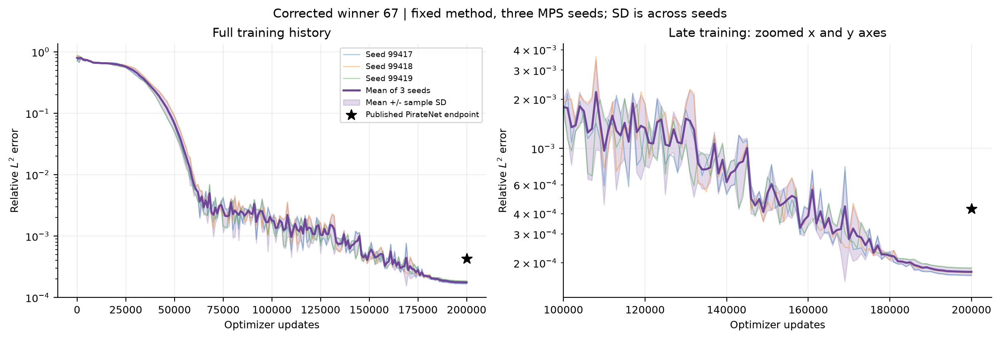
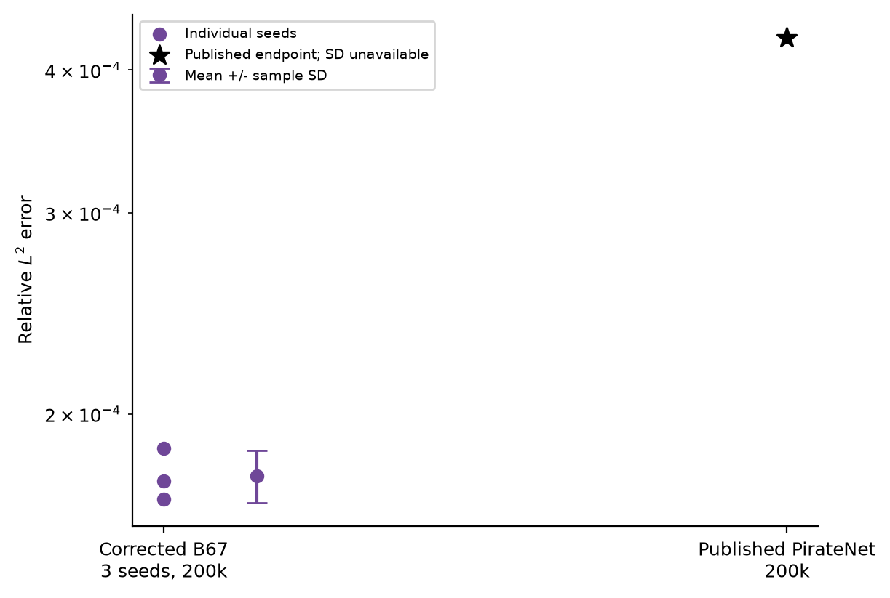
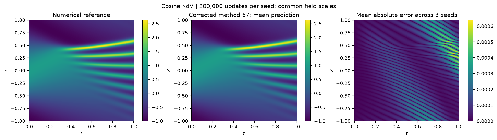
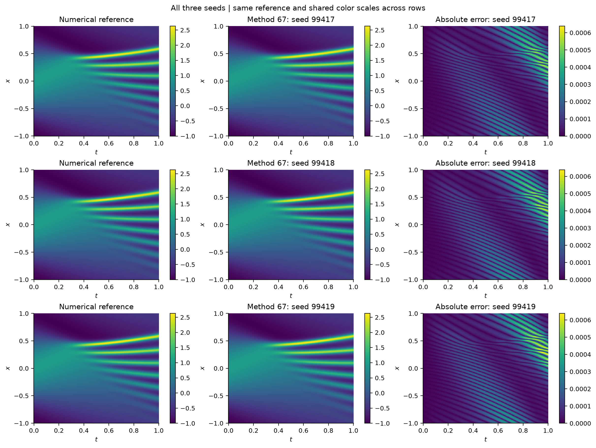
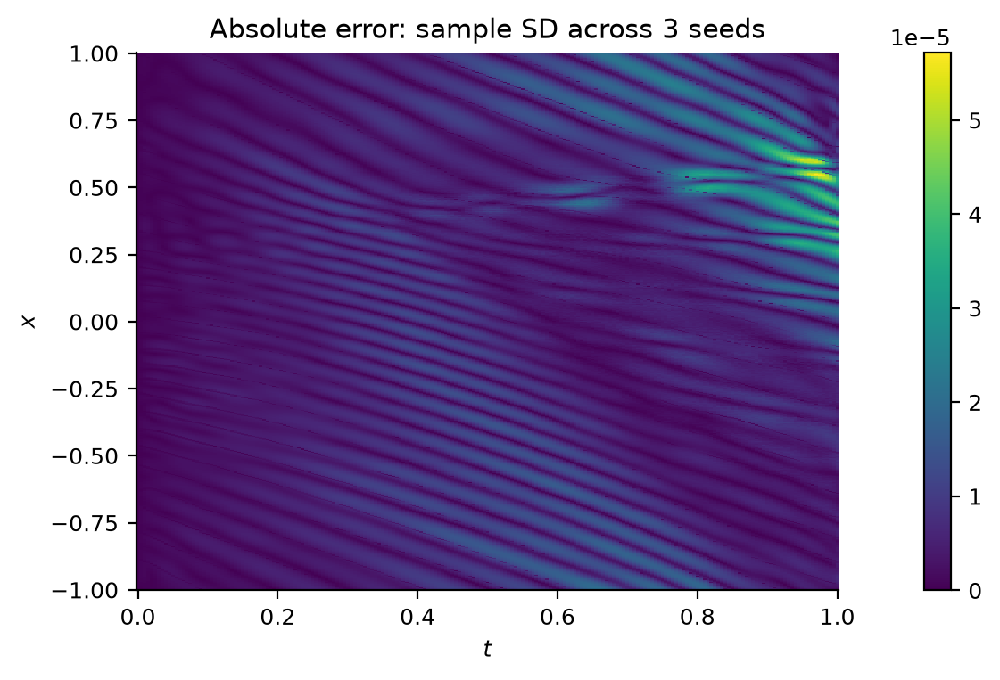

# Corrected winner 67: three-seed results

Each seed trained from fresh weights to exactly 200,000 updates on the cosine KdV test. Identical corrected source, protocol, schedule, batch size, device and PyTorch version; only seed differs. Full per-seed checkpoints and plots remain in their individual folders.

| Seed | Relative L2 | RMSE | First checked step below published error |
|---|---:|---:|---:|
| 99417 | 1.682913e-04 | 1.189877e-04 | 149000 |
| 99418 | 1.747532e-04 | 1.235564e-04 | 146000 |
| 99419 | 1.865145e-04 | 1.318721e-04 | 147000 |

Relative L2: **1.765196e-04 +/- 9.239126e-06** (mean +/- sample SD, n=3).
RMSE: **1.248054e-04 +/- 6.532378e-06**.

Sample SD uses denominator n-1. Error bands are computed from individual seed errors, not errors of an ensemble prediction. Intervals with nonpositive mean-SD lower bounds are omitted on the log plot. Published PirateNet is a single 200,000-step marker, with no invented training trajectory or SD. Reference values were diagnostic only. This is replication of a test-informed correction, not untouched-holdout evidence or an equal-FLOP PirateNet experiment.

The mean-prediction panel is a field visualization only. The error panel averages each seed's absolute error; it is not the absolute error of the mean prediction. The reference is fixed. All field panels use a common field color range, and per-seed error panels share one error scale.

