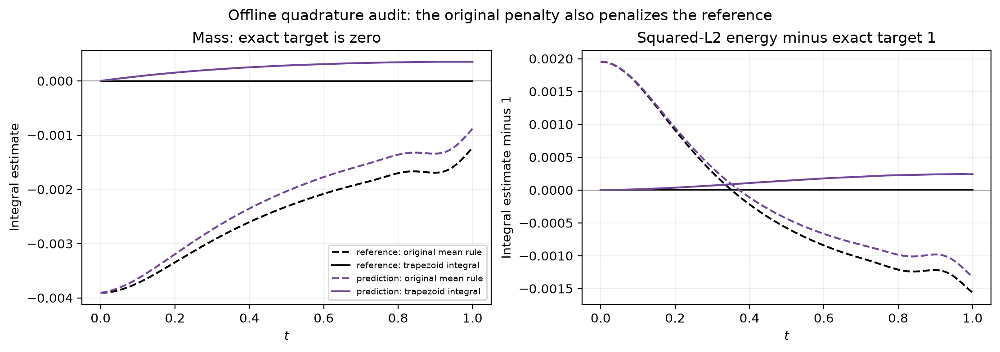

# Offline diagnosis of winner 67

No training was started or changed during this analysis.

## Observed error trajectory

Best evaluated reference error: 7.714199e-04 at 104,000 updates. Final relative L2: 2.050295e-3. The best error is posthoc diagnostic evidence, not a replacement for the predeclared final checkpoint. The 104k point has logged predictions metrics but no retained model checkpoint at that exact update; full checkpoints were saved every 5k.

Independent final full-grid PDE residual MSE: 1.414204e-7 versus original trial 46's 1.656588e-6, despite worse solution error. IC is exact and periodicity remains within tolerance. This establishes a residual-versus-solution ranking mismatch on this single run; it does not identify a unique cause.

## Confirmed conservation quadrature bias

The frozen candidate uses 512 inclusive points on [-1,1], then computes `2*mean(u)` and `2*mean(u**2)`. Both endpoints represent the same periodic location. Giving them equal full weights is not the matching trapezoidal/periodic integral rule.

At the exact cosine IC, this mass estimate is -1/256 = -0.00390625 although true mass is zero; its energy estimate is 1.001953125 although true squared-L2 energy is 1. The hard IC prevents the model from removing this discrepancy at t=0.

Across the released reference trajectory, original-rule mass RMS is 2.612898e-03; trapezoidal mass RMS is 2.212856e-16. Original-rule energy-deviation RMS is 1.081275e-03; trapezoidal deviation RMS is 3.511807e-12. Thus the training regularizer assigns a nonzero penalty to the correct reference solution.

The final model reduces the original-rule discrepancies compared with the reference, but its correctly integrated conservation is worse than trial 46. This is consistent with an objective bias. Only 0.856% of total solution squared error is explained by a time-dependent spatially constant offset, so a simple mean shift does not account for the full error.

## What remains uncertain

Architecture, custom optimizer, regularization and long-run schedule differ from trial 46. This single comparison cannot isolate their causal effects. Mapping a five-minute method to a 200k-step schedule is also an adaptation. The optimizer's projected moment handling should be reviewed before treating the port as a standard SOAP implementation; it is the frozen search candidate, not a newly corrected implementation.

## Suggested next diagnostic

Before another 200k run or seed campaign, compare the frozen method with a clearly labeled variant using trapezoidal integration (or a periodic grid excluding the duplicate endpoint). A second variant with invariant weight zero would isolate the penalty's contribution. Keep initialization, sampling seed and schedule fixed for each paired comparison. Use predefined steps, not the best test checkpoint. Results after this diagnosis are test-informed follow-up experiments, not fresh untouched-holdout evidence. No such runs have been launched.

