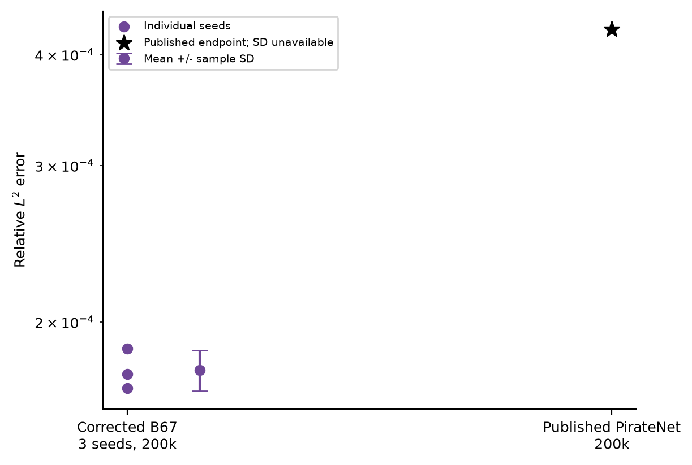

# KdV: 75-trial exploratory campaign

## Setup and baseline

Search uses three development initial conditions, independent weights per case, a 300-second cap or 200,000 updates, a 250,000-parameter cap and 4,096 fresh PDE points per update. Trial 001 starts from the earlier width-160 tanh residual method and records mean physics-validation loss approximately 0.0030404. The final selected Trial 067 reaches 4.689899×10⁻⁵; these are residual losses, not numerical relative-L2 errors.

## Architectural and training exploration

| Trial / stage | Mechanism tested |
|---|---|
| 004 | Sinusoidal activation |
| 011–012 | Schedule-free optimisation and Lookahead |
| 014–021 | Fourier features, harmonic selection and invariant regularisation |
| 026 | AdEMAMix with multiple momentum timescales |
| 032 | Width increase to 176 |
| 042–043 | Higher learning rates; unstable unpreconditioned fits |
| 062–067 | SOAP preconditioning and learning-rate/preconditioner refinements |

The original [decisions](decisions/README.md) distinguish proposed mechanisms from their actual outcomes. Established optimisers and representations are credited to their literature sources.

## Selected method

Trial 067 has 219,650 parameters: seven input features (time, two periodic harmonics, initial state and its spatial derivative), width 176, eight sinusoidal residual layers, one scalar output and a learnable temporal envelope enforcing the initial condition exactly.

SOAP–AdEMAMix uses β=(0.9,0.99,0.999), preconditioner refresh every 80 updates, zero weight decay and learning rate 1.15×10⁻³. The slow-momentum mixing coefficient increases from 0 to 2 during the first 35% of training. Temporal support expands over the same fraction, followed by cosine learning-rate decay to 10⁻⁷. The conservation penalty has weight 0.10 and uses 512 spatial points across eight sampled time slices.

## Final three-seed evaluation

Seeds 99417–99419 each start from fresh weights and train for 200,000 updates with PyTorch 2.14.1/MPS. The evaluation maps the curriculum and optimiser warmup to step fractions and imposes no wall-clock cutoff. Run-loop times are approximately 145.5–149.3 minutes.

Trapezoidal conservation integration was introduced after the cosine benchmark exposed endpoint-inclusive quadrature bias. It leaves the architecture, optimiser and penalty weights unchanged. These three runs evaluate that benchmark-informed variant, rather than an untouched holdout of the original selected implementation.

Relative L2 is ||u_pred−u_ref||₂/||u_ref||₂ over all 102,912 grid pairs. The mean is 1.765196×10⁻⁴ with sample SD 9.239126×10⁻⁶. The three first observed crossings below the published 4.27×10⁻⁴ threshold occur at 149k, 146k and 147k updates. Final checkpoints, not the best observed diagnostic checkpoints, determine the reported errors.



*Three individual fits and mean ± sample SD against the published PirateNet endpoint. Sample SD measures training-seed variability, not a confidence interval or ensemble error.*

## Code and models

`code/candidate.py` contains the evaluated network and SOAP–AdEMAMix implementation; `selected_search_candidate.py` retains the original selected method. `physics.py` contains the original PDE/IC residual and sampling stream. `train.py` is the numerical trainer with simplified file locations; architecture, loss, updates and schedule are retained.

With NumPy, SciPy and PyTorch installed, run a fresh evaluation fit from this repository root:

```bash
python experiments/kdv/code/train.py --reference /path/to/kdv.mat --device mps --seed 99417 --output /path/to/new_run
```

The numerical reference is used for diagnostics, not gradients or stopping. This command starts a full training run. The original reference dataset remains in the source project's protected evaluation files; it is not bundled here. The three saved `results/seed_*/final.pt` files contain the trained weights and optimiser state.
