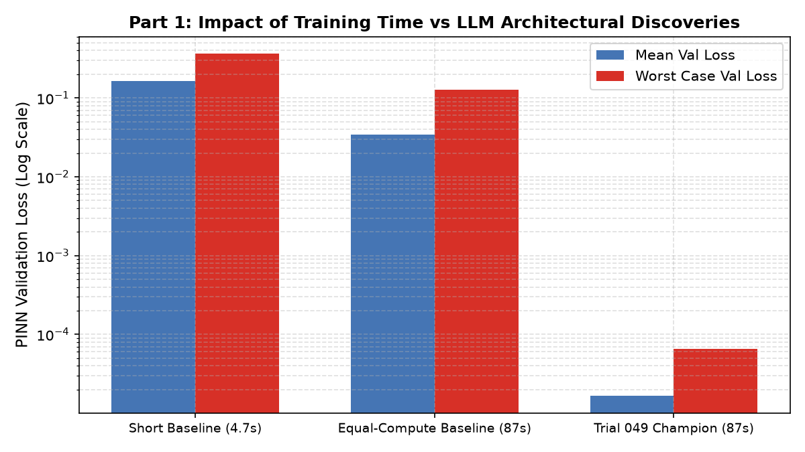

# Sitnikov restricted three-body experiment

The model solves z′=v and v′=−z/(z²+ρ(t,e)²)^(3/2), with ρ=(1−e cos E)/2 and E−e sin E=t mod 2π. Coordinates, initial conditions and reported errors use the source's nondimensional conventions. There are 50 attempted methods and ten development IVPs, a 90-second training cap, 500 training coordinates and 2,000 separate validation coordinates over [0,6π]. Selection uses final weights and fixed PINN loss; numerical trajectories are reserved for owner evaluation.

Selected Trial 049 is assessed against DOP853 on ten held-out physical IVPs, with fresh weights per case. `evidence/benchmark_comparison.json` contains the per-case measurements for the baseline and selected/milestone methods. `table_heldout_benchmark.csv` and `final_summary.json` independently record the aggregate values.

Position mean RMSE changes from 1.6904742709184908 to 0.9579833403672205; velocity from 0.7317351484539278 to 0.4509443210153374. Reduction is 100×(1−mean_winner/mean_baseline), approximately 43.33% and 38.37%. This is a ratio of means, not the mean of per-case percentage changes. The baseline averages 4.74 seconds and 4,898 parameters; 049 averages 87.01 seconds and 84,874 parameters. A common 90-second cap did not produce equal actual computation.

Untrained extrapolation (6π,12π] is a different metric: selected mean position RMSE is 2.4190 and velocity RMSE 0.86755, versus baseline 2.75973 and 0.68289. Velocity extrapolation is worse. The in-interval reductions do not establish reliable long-term prediction.

The separate development follow-up retrains the baseline for 87 seconds and repeats methods across five training seeds. Its reported development residual advantage is not an equal-budget held-out trajectory advantage. The source's causal wording is stronger than the evidence needed here; inspect the ablations before attributing gains to any individual component. Included `followup_statistical_summary.json` preserves the recorded statistics, without merging them into the original held-out benchmark.

See the trial ledger and selected [decision record](../../reports/decisions/sitnikov049.md). Raw trajectories/checkpoints remain linked through the source commit; this audit did not rerun DOP853 or reload trained networks.
