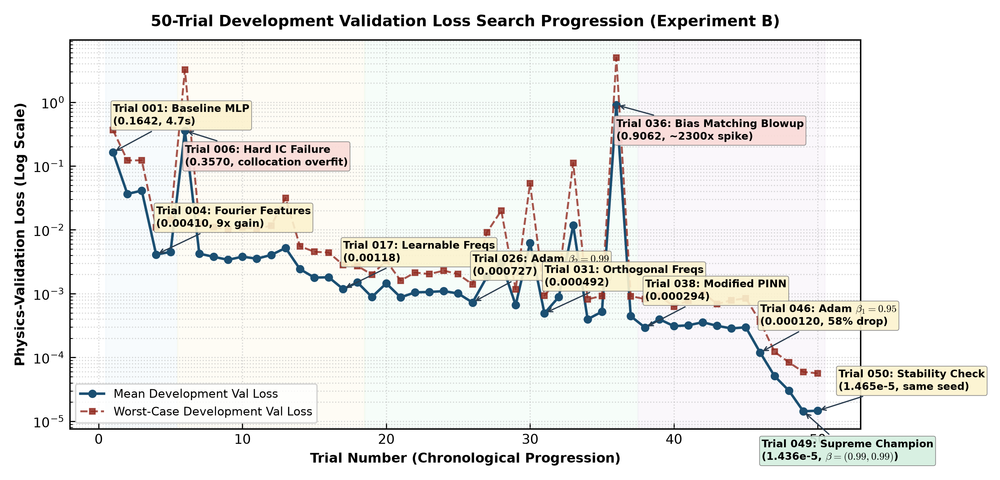
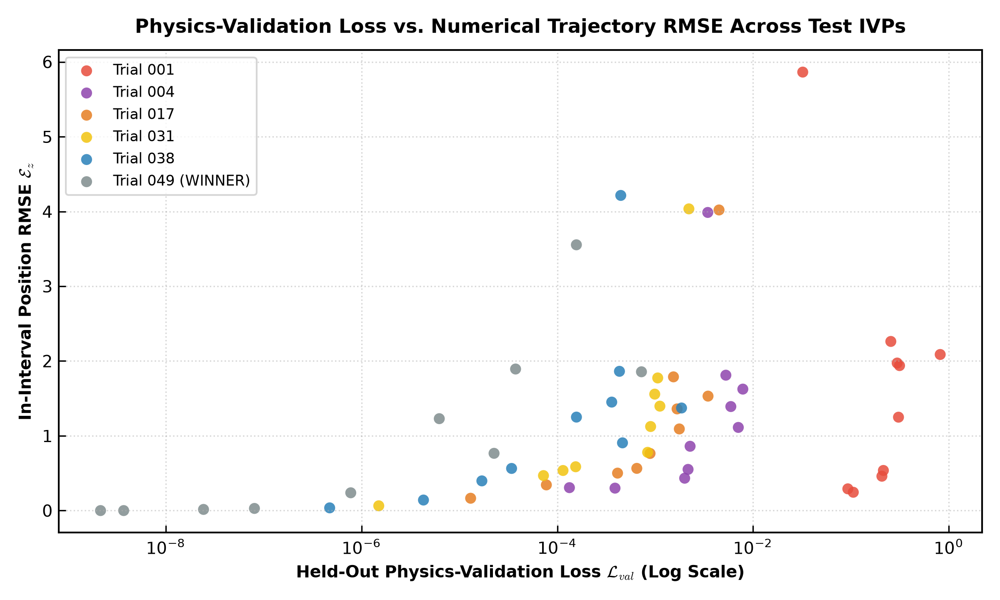
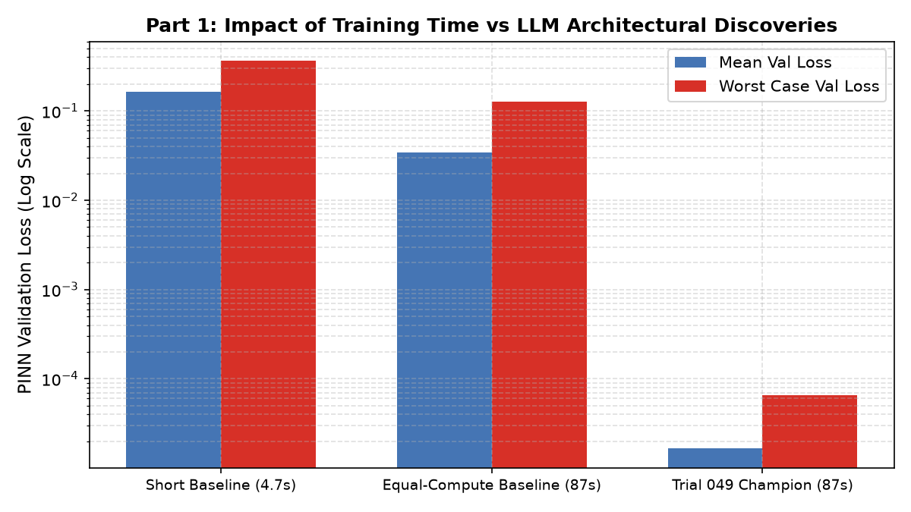

# Sitnikov: 50-trial research campaign

## Setup and baseline

Ten development IVPs vary eccentricity and initial position/velocity. Each method is fitted independently per IVP, using 500 training times over [0,6π], a 90-second cap and at most 250,000 parameters. Fixed validation uses 2,000 separate times and the two first-order ODE residuals plus 100 times initial-condition error. Selection uses final weights.

Trial 001 is a three-layer tanh MLP with 4,898 parameters and 1,000 Adam updates. It uses only about 4.74 seconds per case. The selected method has 84,874 parameters and uses about 87 seconds per case.

## Approaches investigated

| Trial / stage | Main idea |
|---|---|
| 002–003 | Longer training and temporal curriculum |
| 004 | Fixed Fourier features |
| 017 | Learnable Fourier residual network |
| 031 | Fourier frequencies initialised to k/3 over the training interval |
| 038 | Modified PINN with gated feature mixing |
| 049 | Combine the gated representation, frequency initialisation, IC schedule and Adam β=(0.99,0.99) |

The [trial records](decisions/README.md) retain hypotheses, observed outcomes and rejected changes. Their mechanistic explanations are research hypotheses rather than established causal conclusions.

## Selected architecture and training

Trial 049 uses eight learnable frequencies, width 192 and two gating stages. It predicts z and v together. Training is full-batch over the 500 allowed times, with cosine learning rate 10⁻³→10⁻⁶ and gradient norm clipping at 0.5. Initial-condition weight decreases linearly from 2000 to 10 over the first 20% of training, then remains at 10.

## Held-out results

On ten new IVPs, mean in-interval position RMSE falls from 1.690474 to 0.957983 and velocity RMSE from 0.731735 to 0.450944. The reductions are 43.33% and 38.37%, calculated from the means. These are not equal-actual-time comparisons.

*Development physics loss across 50 trials, including unsuccessful changes.*

## Important observations

Some high-eccentricity cases retain large trajectory errors despite small residuals. The selected method's untrained extrapolation to (6π,12π] has mean position RMSE 2.4190 and velocity RMSE 0.86755; the original baseline's values are 2.75973 and 0.68289. Improvement within the fitted interval does not imply improved velocity extrapolation.

*Held-out physics loss versus position RMSE for milestone methods.*

A separate 87-second development follow-up repeats methods across five training seeds and compares the baseline at matched time. Its saved statistics are in `results/followup_statistical_summary.json`; they concern development residuals, not a replacement for the held-out trajectory comparison.

*Development residual comparison at 87 seconds, distinct from the original short-baseline held-out results.*
