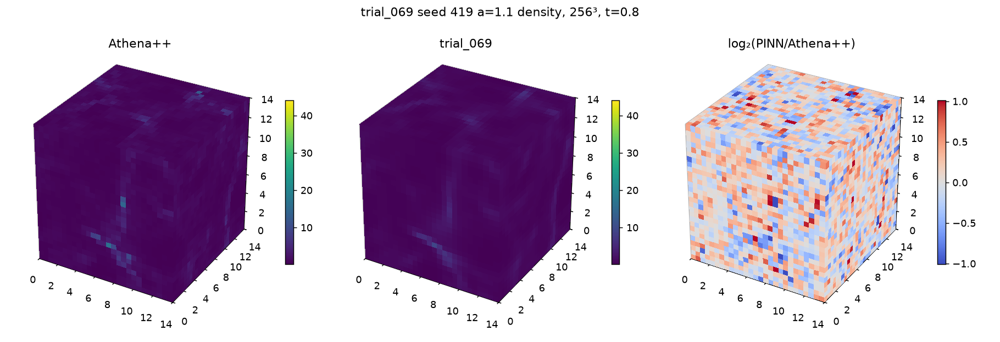
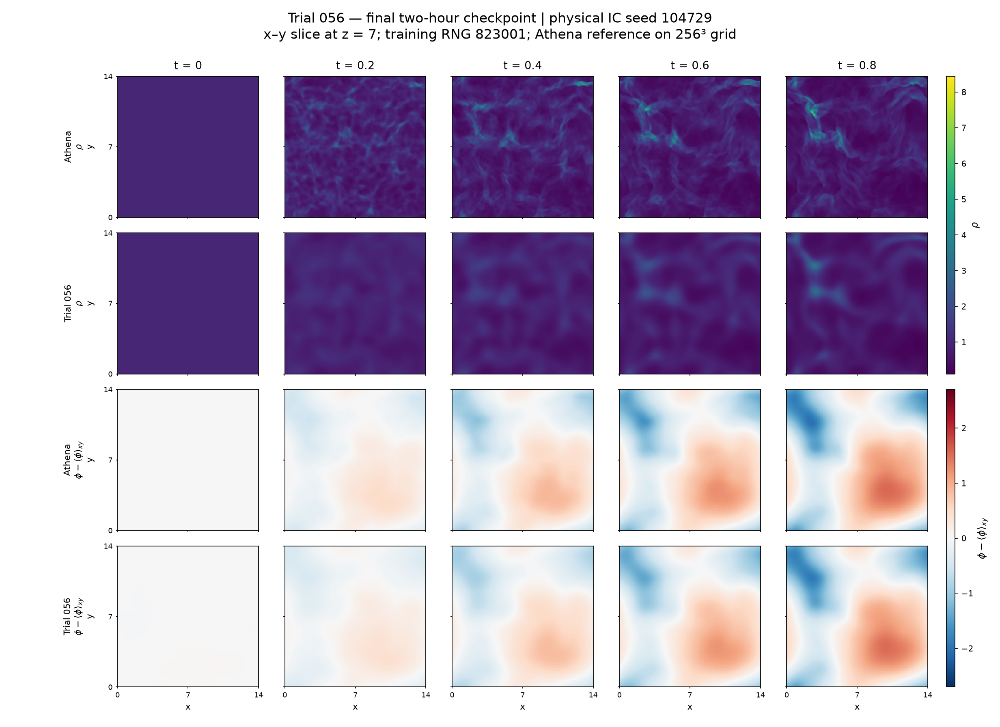
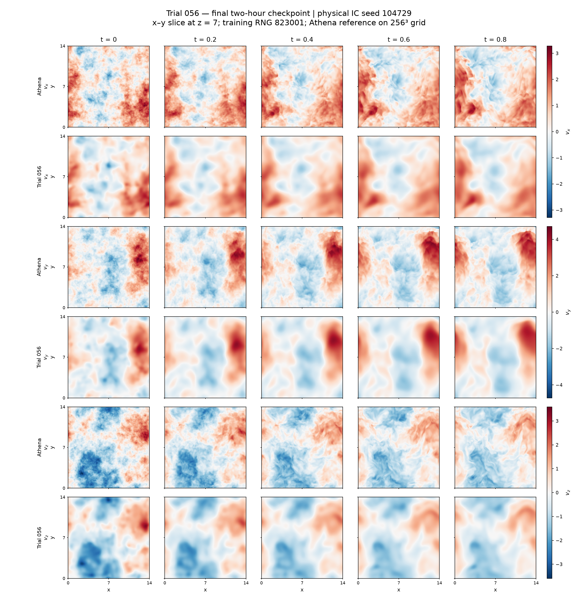

# 3D supersonic self-gravitating turbulence

We approximate isothermal Euler–Poisson flow in a periodic three-dimensional box:

\[
\rho_t+\nabla\!\cdot(\rho\mathbf v)=0,\qquad
\mathbf v_t+(\mathbf v\!\cdot\nabla)\mathbf v
=-c_s^2\nabla\log\rho-\nabla\Phi,\qquad
\nabla^2\Phi=4\pi G(\rho-\rho_0).
\]

Inputs are space–time coordinates and generated turbulent initial conditions. The networks predict density, three velocity components and potential. Physics/initial-condition validation guides selection; Athena++ fields provide later numerical comparisons.

## Original 75-trial campaign: Trial 069

Trial 069 uses a width-256 periodic sinusoidal residual network, staged initial-velocity fitting, Adam and stratified time sampling. Fresh approximately 30-minute fits on physical seeds 419, 733 and 947 reduce mean density RMS log₂ error from **0.479899 to 0.395721**, a **17.54% reduction** relative to local paper-style P. Errors cover all 256³ cell centres at t=0.8. Trial 069 misses the original IC eligibility threshold on seed 733.

*Seed 419, amplitude 1.1: Athena++, Trial 069 and signed log₂ density discrepancy. The rendering shows exterior faces; the reported error averages the full native volume.*

## Newer 60-trial campaign: Trial 056

Sixty attempted methods span optimisers, activation/representation changes, PINN training techniques and classical optimisation. Final Trial 056 combines width-256 Snake layers, random weight factorisation, input skips and time-conditioned FiLM, with Adan/AdaBelief followed by limited-memory SR1/Krylov cubic regularisation.

Completed two-hour evaluation: **one physical initial condition, seed 104729**, with **three paired training seeds 823001/823002/823003** for each method. This is six fits, not three different physical cases.

| Full-volume metric at t=0.8 | Trial 056, mean ± sample SD | Local P, mean ± sample SD |
|---|---:|---:|
| Density relative L2 | 0.341969 ± 0.000353 | 0.372813 ± 0.002267 |
| Density RMS log₂ ratio | 0.411362 ± 0.001305 | 0.465419 ± 0.001118 |
| Velocity-vector relative L2 | 0.267968 ± 0.000511 | 0.297676 ± 0.000584 |

*Trial 056 versus Athena++: 256×256 xy slices at z=7, five physical times, seed 104729 and training seed 823001. Density is untransformed; displayed potential is slice-mean-centred.*

*Signed velocity components for the same slice and fixed two-hour checkpoint. Full-volume errors use all 16,777,216 cells.*

[Experimental report](report.md) · [Both campaigns' trial decisions](decisions/README.md) · [Selected methods](code/) · [Numerical results](results/)
